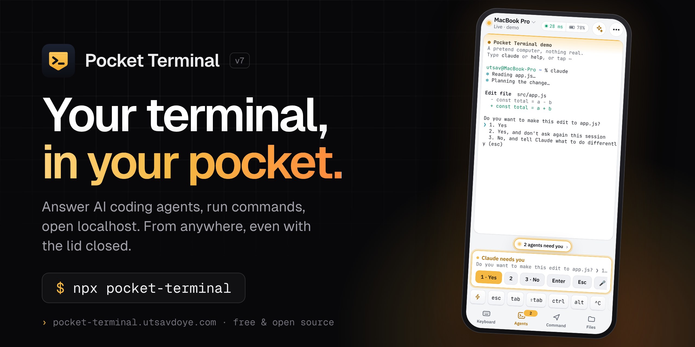

<p align="center">
  <a href="https://pocket-terminal.utsavdoye.com"></a>
</p>

<p align="center">
  <a href="https://www.npmjs.com/package/pocket-terminal"></a>
  <a href="https://www.npmjs.com/package/pocket-terminal"></a>
  <a href="https://github.com/utsavdoye/pocket-terminal/actions/workflows/test.yml"></a>
  <a href="LICENSE"></a>
  
</p>

<p align="center">
  <a href="https://pocket-terminal.utsavdoye.com"><b>Website</b></a> ·
  <a href="https://pocket-terminal.utsavdoye.com/app/#demo"><b>Live demo</b></a> ·
  <a href="#install">Install</a> ·
  <a href="#how-it-works">How it works</a> ·
  <a href="#security">Security</a> ·
  <a href="https://pocket-terminal.utsavdoye.com/help.html">Help</a>
</p>

**Pocket Terminal** puts your computer's terminal on your phone. It works from any network, and it
keeps working when the laptop is asleep in your bag with the lid closed.

Start Claude Code, close the laptop, leave. When the agent stops to ask *"Do you want to make this
edit?"*, your phone buzzes and you answer with one tap. The same connection opens your
`localhost:3000`, moves files, and tells you when a long build finishes.

Phone and computer talk directly to each other, end-to-end encrypted. There is no server to run,
no account, and nothing to configure on your router.

```bash
npx pocket-terminal
```

<p align="center">
  
</p>

## Features

**For AI agents**
- Phone notification when Claude Code, Codex, Aider or any program asks a question, with one-tap answers.
- "It's done" alerts when a build, download or training run finishes or goes quiet.
- The computer stays awake while a program is working, even on battery with the lid closed.

**A real terminal**
- zsh, bash or PowerShell with colours, tab completion, and Ctrl, Esc and arrow keys on a touch key bar.
- Several terminals at once. Programs keep running when you close the app.
- Send a command while the computer sleeps; it runs at the next check-in and the reply comes back to you.

**Beyond the terminal**
- Open the computer's `localhost` sites on your phone, privately, from any network.
- Download files from the computer, or upload into a project folder.
- Share a live, view-only link to one terminal. It expires.
- Ask in plain English ("free up port 3000") and get the right command for your system, explained, with a safety label. Works offline for 70+ common commands; optional AI with your own key.

<p align="center">
  
  
  
  
</p>

## Install

You need macOS, Windows 10/11 or Linux with [Node.js 18.20+](https://nodejs.org), and an iPhone or Android phone.
Setup takes about five minutes. To look around first, open the [live demo](https://pocket-terminal.utsavdoye.com/app/#demo); nothing to install.

**1. On your computer**

```bash
npx pocket-terminal
```

Or without npm:

```bash
curl -fsSL https://pocket-terminal.utsavdoye.com/install.sh | bash     # macOS, Linux
irm https://pocket-terminal.utsavdoye.com/install.ps1 | iex            # Windows PowerShell, no admin
```

On a Mac it asks for your password once, so it can manage sleep (it may only run four exact `pmset` commands).
Linux laptops ask once for wake-up alarms. Run the same line again any time to update; your pairing stays.
It finishes by showing a one-time QR code.

**2. On your phone**

Open [pocket-terminal.utsavdoye.com/app](https://pocket-terminal.utsavdoye.com/app/) and add it to your home screen
(iPhone: Share → Add to Home Screen; Android: ⋮ → Install app). Open it from the home screen and tap **Scan QR code**.

> On iPhone, pair inside the home-screen app, not in Safari. iPhone keeps the two separate.
> Notifications need iOS 16.4 or newer.

**3. Approve**

Both screens show the same 6-digit code. If they match, type `y` on the computer, then choose a PIN on the phone.

<details><summary>Install from source or from your own fork</summary>

```bash
git clone https://github.com/utsavdoye/pocket-terminal.git
cd pocket-terminal/agent
bash install.sh                                          # macOS, Linux
powershell -ExecutionPolicy Bypass -File install.ps1     # Windows
```

The phone app handles your key, so the most careful setup hosts your own copy: fork the repo, then
**Settings → Pages → Deploy from a branch**, `main`, `/docs`. The installer detects a fork and uses
`https://<you>.github.io/pocket-terminal/app/`.
</details>

### Commands

| Command | What it does |
|---|---|
| `npx pocket-terminal` | Install or update, then pair a phone |
| `npx pocket-terminal pair` | Pair another phone |
| `npx pocket-terminal list` | Show the phones that can connect |
| `npx pocket-terminal remove 2` | Lock a phone out (number, name or `all`) |
| `npx pocket-terminal logs` | Follow the agent's log |
| `npx pocket-terminal uninstall` | Remove it (`--purge` also deletes the pairing key) |

## How it works

<p align="center">
  
</p>

1. **Pairing, once per phone.** The computer shows a one-time QR code. After you approve the matching
   6-digit code, it gives that phone its own key, wrapped with a fresh ECDH exchange, so a photo of the
   QR code is useless. The code then expires.
2. **Finding each other.** Both sides use a free public message board ([ntfy.sh](https://ntfy.sh)) as a
   mailbox. The mailbox name and every note are encrypted with your key.
3. **Direct link.** The two devices exchange connection details and open a direct WebRTC link, the
   same technique video calls use. Your terminal flows straight between them.

If a strict network blocks direct links, commands still travel as encrypted notes through the board. Slower, but it works.

### Lid closed, battery safe

<p align="center">
  
</p>

| Your computer is | Your command runs |
|---|---|
| Plugged in, lid closed | Instantly |
| On battery, used in the last 30 minutes | Within about 1 minute |
| On battery, idle for hours | Within about 2 minutes |
| On battery, Instant mode on | Instantly (uses more battery) |
| Below 10% battery | After you charge |

Each check-in keeps the computer awake for about 6 seconds. It never stays awake below 20% battery.
Change any of this from the phone under **⋯ → Power and battery**.

## Security

- **End-to-end encrypted.** AES-256-GCM for notes, DTLS for the direct link. Link fingerprints travel inside the authenticated notes, so nobody can sit in the middle.
- **Only phones you approve.** Each QR code works once, for 10 minutes, and only after you type `y` next to a matching code. Every phone has its own key and can be removed in seconds.
- **PIN-locked on the phone.** The key is encrypted with your PIN; 10 wrong tries wipe it.
- **Nothing readable in transit or in logs.** The board sees only ciphertext. Commands, output and file names are never logged. Notifications are encrypted for your phone (standard Web Push).
- **Least privilege.** Four `pmset` commands on macOS, two `rtcwake` commands on Linux, no admin on Windows.
- **View-only shares are enforced on the computer** and expire.
- **AI is opt-in.** Off until you add your own key; it sees only what you type in Ask and never runs anything without your tap.

See [SECURITY.md](SECURITY.md) for the full threat model, including what it does not protect against, and how to report a vulnerability.

## Limits

- The computer must be on and online. Asleep is fine; shut down is not.
- The message board is a free public service with a daily limit that is plenty for personal use. You can [run your own](#advanced).
- Some strict networks block direct links; you then get the slower backup route.
- Windows support is newer. Windows cannot report the lid state, so on battery it sleeps after 10 minutes without input, and some "Modern Standby" laptops ignore wake alarms on battery.
- Local websites load through the app, so live reload (WebSockets) does not work yet.

## FAQ

<details><summary><b>Is there really no server?</b></summary>

There is no server you run and none that can read your data. Two devices on different networks need a
public meeting point, so a free message board passes a few encrypted notes. Your live terminal never goes through it.
</details>

<details><summary><b>How is this different from SSH or Tailscale?</b></summary>

Those assume the computer is awake and reachable. Pocket Terminal is built around a laptop that is asleep:
it wakes briefly to check for work, runs it, replies and sleeps again. Keep using SSH where it fits; this covers the moments it can't.
</details>

<details><summary><b>What does it cost in battery?</b></summary>

Each check-in is a few seconds awake, typically a few percent overnight. Your real numbers are in `npx pocket-terminal logs`.
</details>

<details><summary><b>I lost my phone.</b></summary>

Run `npx pocket-terminal list`, then `npx pocket-terminal remove <number>`. That phone is locked out within seconds, and its PIN-locked key is useless.
</details>

## Advanced

- **Your own message board:** run [ntfy](https://docs.ntfy.sh/install/), then `node pair.js --board https://ntfy.example.com` in `~/.pocket-terminal/app/agent` and re-pair. List several boards for redundancy.
- **TURN server** for networks that block all direct links: add it to `"iceServers"` in `~/.pocket-terminal/direct.json`.
- **Different shell on Windows:** set `POCKET_SHELL` to `pwsh.exe` or `cmd.exe`.
- **Relay mode** with an always-on server in the middle: see [`relay/`](relay/).

## Development

```
cli.js        npx entry: copies the agent to ~/.pocket-terminal/app and runs its installer
agent/        runs on the computer: direct link, power manager, terminals, files, web push, pairing
docs/         the website, and the phone app in docs/app (static, served by GitHub Pages)
test/         offline end-to-end tests: fake board, fake sleeping computer, real WebRTC in a browser
relay/        optional self-hosted relay
```

```bash
cd agent && npm test         # unit tests: power manager, platform parsers, Web Push, boards
python3 test/e2e_direct.py   # phone app in a headless browser ⇄ agent, including sleep and wake
python3 test/e2e_tools.py    # notifications, terminals, files, local websites, sharing
```

The other end-to-end suites in `test/` cover pairing, QR scanning, reconnecting, touch input and demo mode.
Contributions are welcome; read [CONTRIBUTING.md](CONTRIBUTING.md) first.

## Support the project

Pocket Terminal is free and built in spare time. If it saves you trips back to your laptop, you can
[buy me a coffee](https://buymeacoffee.com/utsavdoye) or simply star the repo so others find it.

## License

[MIT](LICENSE) © [Utsav Doye](https://github.com/utsavdoye)
